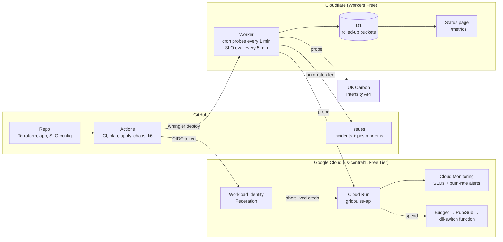

# GridPulse

**SLOs, error budgets and burn-rate alerting for a GCP service, measured from the edge, run for €0.**

GridPulse treats a small Cloud Run API and a real upstream dependency (the GB grid's carbon-intensity API) like production services. It defines SLOs once, measures them from two independent vantage points, alerts on error-budget burn rate, opens incidents as GitHub issues, and makes chaos experiments and load tests one click away. Everything is code, deployed by GitHub Actions without a single stored cloud key.

## Live links

| | |
|---|---|
| Status page | https://status.fde.lt |
| Prometheus metrics | https://status.fde.lt/metrics |
| Incident history | [Issues labelled `incident`](../../issues?q=label%3Aincident) |
| Experiment log | [chaos workflow runs](../../actions/workflows/chaos.yml) |

## Architecture



**Why two vantage points?** Cloud Monitoring measures the server side from Cloud Run's own request metrics. The Worker measures what a client sees from outside Google's network. Monitoring also has to survive the failure it is reporting on, so it sits outside the blast radius. When the two views disagree, that disagreement is itself a diagnosis: errors at the edge but not in Cloud Run point at DNS, TLS or the front end, not the code.

## SLOs

Defined once in [`config/slos.json`](config/slos.json). The Worker imports the file and Terraform reads it with `jsondecode`, so the edge and the platform can never drift apart.

| SLO | SLI | Objective | Window |
|---|---|---|---|
| `api-availability` | Non-5xx responses / all responses | 99.5% | 28 days |
| `api-latency` | Responses under 800 ms / all responses | 99% | 28 days |
| `carbon-availability` | Successful probes of the upstream API / all probes | 99% | 28 days |

The upstream SLO is deliberate: you cannot fix a dependency, but you can measure it, set expectations from it, and stop paging people for it.

## Alerting: multi-window, multi-burn-rate

Burn rate is how fast the error budget is being spent, relative to spending it exactly over the window:

```
burn rate = observed error ratio / (1 - objective)

99.5% SLO allows 0.5% errors.
  2% errors  ->  4x burn: budget gone in 7 days instead of 28
  7.2% errors -> 14.4x burn: 2% of the monthly budget gone in 1 hour
```

| Rule | Severity | Long window | Short window | Burn rate | Budget spent |
|---|---|---|---|---|---|
| fast-burn | page | 1h | 5m | > 14.4x | 2% in 1 hour |
| medium-burn | page | 6h | 30m | > 6x | 5% in 6 hours |
| slow-burn | ticket | 3d | 6h | > 1x | 10% in 3 days |

A rule fires only when **both** windows exceed the threshold. The long window proves the problem is significant (no pages for a single blip). The short window proves it is still happening, so the alert clears within minutes of recovery instead of hours. The same rules generate Cloud Monitoring alert policies via `select_slo_burn_rate()` and drive the Worker's own evaluation, which is unit-tested in [`worker/test/slo.test.ts`](worker/test/slo.test.ts).

## Incidents and postmortems

When a rule fires, the Worker opens a GitHub issue with the SLO, the matching rule, a burn-rate table, a timeline and a responder checklist. It comments if the severity changes and closes the issue after 15 quiet minutes (hysteresis, so a flapping service doesn't open ten issues). The closing comment links the [blameless postmortem template](docs/postmortems/TEMPLATE.md). Responders follow the [runbook](docs/runbook.md).

## Game days

| Workflow | What it does |
|---|---|
| [`chaos`](.github/workflows/chaos.yml) | Sets `CHAOS_ERROR_RATE` / `CHAOS_LATENCY_MS` on Cloud Run with `gcloud`, holds, then reverts. Terraform ignores these env vars so it never silently undoes a running experiment. |
| [`loadtest`](.github/workflows/loadtest.yml) | k6 ramp to a capped number of users. Thresholds mirror the SLOs, so a run fails exactly when it would burn budget too fast. |

A typical experiment: run `chaos` with `error_rate=0.3` for 30 minutes. Probes fail within a minute, fast-burn fires after about 10 minutes (once the 1h window has enough events), an issue opens, Cloud Monitoring alerts in parallel, and both clear after the revert. Then write the postmortem.

## Cost: €0 by design

| Component | Free allowance | GridPulse usage |
|---|---|---|
| Cloud Run | 2M requests, 180k vCPU-s / month | ~45k probe requests / month, scales to zero |
| Cloud Monitoring | Google Cloud metrics free | Built-in Cloud Run metrics only, no custom metrics |
| Artifact Registry | 0.5 GB | ~10 MB distroless image, cleanup policy keeps 3 |
| Cloud Storage | 5 GB in US regions | Terraform state + function source in `us-central1` |
| Workers / D1 | 100k requests/day; D1 5M reads, 100k writes/day | ~1.4k cron runs/day, ~0.5M reads, ~10k writes/day |
| GitHub Actions | Free for public repos | |

Guardrails, because "free" needs enforcement:

- **Budget kill switch.** A GCP budget only alerts; it never stops spend. Here budget notifications go to Pub/Sub, and a function unlinks billing from the project once spend reaches the budget ([`functions/budget-kill-switch`](functions/budget-kill-switch/main.py)).
- **Hard ceilings.** Cloud Run `max_instance_count = 2`, request-based billing (CPU only during requests), load tests capped at 50 users.
- **D1 sized to the free plan.** Probes are rolled into 5-minute and hourly buckets instead of stored raw, so an SLO evaluation reads under ~1,000 rows instead of scanning 28 days of samples.
- **Labels** (`app`, `cost-center`) on every resource for showback.

## Security

- **No service-account keys anywhere.** GitHub Actions exchanges its OIDC token through Workload Identity Federation. The provider rejects tokens from any repository except this one.
- **Least privilege split.** The `foundation` stack (identities, budget, kill switch) is applied by a human. CI applies only the `service` stack, as a deployer that can manage Cloud Run and monitoring but cannot change IAM or billing, and can only write its own Terraform state prefix.
- **Distroless, non-root** container image.
- The GitHub token used by the Worker is a fine-grained PAT scoped to Issues on this repository, stored as a Worker secret.

## Repository layout

```
app/                     Go API for Cloud Run (chaos via env, JSON logs for Cloud Logging)
config/slos.json         SLOs and alert rules: single source of truth
worker/                  Cloudflare Worker: probes, SLO math, incidents, status page, /metrics
infra/gcp/foundation/    WIF, service accounts, registry, budget + kill switch (applied by a human)
infra/gcp/service/       Cloud Run, SLOs, burn-rate alert policies (applied by CI)
functions/               Budget kill switch (Cloud Run functions, Python)
loadtest/                k6 script
docs/                    Runbook and postmortems
.github/workflows/       CI, deploys, chaos, load test
```

## Setup

Prerequisites: a GCP project with a billing account attached, a Cloudflare account, `gcloud`, `terraform` and Node 22.

**1. GCP foundation** (once, as project owner):

```bash
gcloud auth login && gcloud auth application-default login
scripts/bootstrap-gcp.sh <project-id> <billing-account-id>
```

The script creates a versioned state bucket in `us-central1`, applies the foundation stack and prints the GitHub variables to set. The budget currency defaults to EUR; pass `-var budget_currency=USD` if your billing account is in USD.

Deploy workflows skip themselves until their variables exist, so a fresh fork stays green.

**2. GitHub repository variables** (Settings > Secrets and variables > Actions):

| Variable | Value |
|---|---|
| `GCP_PROJECT_ID`, `TF_STATE_BUCKET`, `GCP_WORKLOAD_IDENTITY_PROVIDER`, `GCP_DEPLOYER_SA` | printed by the bootstrap script |
| `ALERT_EMAIL` | where Cloud Monitoring alerts go |
| `API_URL` | Cloud Run URL, after the first deploy (used by `loadtest`) |
| `CLOUDFLARE_ACCOUNT_ID` | from the Cloudflare dashboard (not secret; enables `deploy-worker`) |

| Secret | Value |
|---|---|
| `CLOUDFLARE_API_TOKEN` | API token with *Workers Scripts: Edit*, *D1: Edit* and *Zone: Workers Routes: Edit* (zone `fde.lt`) |
| `INCIDENT_GITHUB_TOKEN` | Optional. Fine-grained PAT with *Issues: Read and write* on this repo only, so the Worker can open incidents |

Create a `production` environment too (optionally with required reviewers, which gates every deploy).

**3. Deploy the API.** Run the `deploy-gcp` workflow and copy the URL from the run summary into the `API_URL` variable.

**4. Deploy the Worker.** Run the `deploy-worker` workflow (it also runs on every push to `worker/`). It is fully hands-off: it creates the D1 database on the first run, applies migrations, injects `API_URL`, deploys, attaches `status.fde.lt` with a certificate, and syncs the incident token. The first SLO evaluation appears within 5 minutes.

**5. Custom domain.** The zone must be on the same Cloudflare account. Change the `routes` pattern in `wrangler.toml` to use your own domain.

**6. (Optional) Grafana Cloud.** In the free tier, add a *Metrics Endpoint* scrape job pointing at `/metrics` to chart burn rates alongside the Cloud Monitoring view.

## Trade-offs and known limits

- **Probe volume is low** (1 per minute per target), so short windows hold few events. A `min_events_long_window` guard stops a single failure from paging. Real services alert on real traffic; probes here are a deliberate free-tier compromise.
- **Window edges are bucket-aligned.** Windows read whole 5-minute or hourly buckets, so a "5m" window covers 5 to 10 minutes. Fine for alerting, documented rather than hidden.
- **One probe location.** Cron triggers run in one Cloudflare location, so this measures reachability, not global latency.
- **The kill switch is blunt.** Unlinking billing stops everything in the project, which is the right trade for a portfolio project and the wrong one for production.

## Running locally

```bash
cd app && go test ./... && go run .                       # API on :8080
CHAOS_ERROR_RATE=0.5 go run .                             # with injected faults
cd worker && npm ci && npm test && npx wrangler dev --test-scheduled
curl "http://localhost:8787/__scheduled?cron=*+*+*+*+*"   # trigger a probe
```
